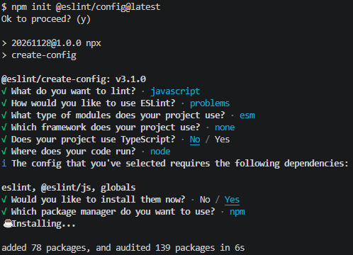

- npm init
- npm i dotenv linebot axios
- npm init @eslint/config@latest
    
npm i -D eslint-config-prettier eslint-plugin-prettier prettier nodemon
修改 eslint.config.js 

npm run dev
連接埠轉發3000
可見度: 公用